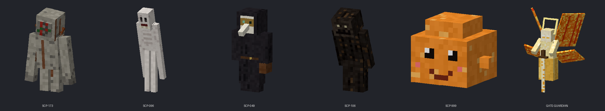

# SCP: Breach Protocol

A NeoForge **1.21.1** mod: build a Foundation site, contain anomalies, and survive when the power goes out.
It has no library dependencies, just NeoForge.

All code, models, textures and sounds in this project are original. SCP concepts come from the
[SCP Foundation wiki](https://scp-wiki.wikidot.com) and are licensed **CC BY-SA 3.0**. If you publish this mod,
keep that credit, and release SCP-derived content under CC BY-SA too.



## Building

```
./gradlew build          # jar lands in build/libs/breachprotocol-0.1.0.jar
./gradlew runClient      # launches a dev client with the mod loaded
```
Requires JDK 21. The first build downloads Minecraft + NeoForge (a few minutes).
If Gradle complains about the ModDevGradle or NeoForge version, bump `net.neoforged.moddev` in
`build.gradle` or `neo_version` in `gradle.properties` to the latest 1.21.1 release.

## The anomalies

| | Behaviour |
|---|---|
| **SCP-173** (Euclid) | Completely frozen while any player can see it. When nobody's watching, because you blinked, looked away or the lights went out, it lunges up to 4 blocks and snaps necks (50 damage). Takes half damage except from explosions. |
| **SCP-096** (Euclid) | Weeps quietly, hands over its face. If you look straight at its face, it screams through a ~5 second wind-up, then hunts **everyone who saw it** across up to 160 blocks. It smashes doors, glass and wood (anything with blast resistance under 6). Carved pumpkins and closed eyes protect you. |
| **SCP-049** (Euclid) | A polite plague doctor whose touch withers. Anyone (player or villager) it kills rises as **SCP-049-2**. It talks to you while it hunts. |
| **SCP-049-2** | The doctor's "cured" patients. Zombies that never burn and are never babies. |
| **SCP-106** (Keter) | Slow, and it trails sticky corrosion. If it can't reach you or you get too far away, it **sinks into the floor and rises right behind you**. A containment field only holds it for so long. |
| **SCP-999** (Safe) | A friendly orange blob that follows you, regenerates anyone nearby and scrubs off SCP-106's corrosion. Right-click it for a hug. Feed it cookies or cake and it sometimes leaves eyedrops. |

## New mechanics (not in the original mod)

### Blink meter
When SCP-173 is within 32 blocks, a **BLINK** bar appears at the top of your screen. It empties in about 9 seconds,
then you blink for 6 ticks, which is long enough for 173 to move. Hold **B** (rebindable: *Close Eyes*)
to keep your eyes shut. That keeps you safe from 096's face but leaves you helpless against 173. Opening your eyes refills the bar.
**Eyedrops** stop the drain for 30 seconds.

### Lighting matters
In darkness (light level under 4), you can't see an anomaly more than 4 blocks away unless you have Night Vision.
Cut the lights and 173 walks. 096's face can't trigger in the dark either.

### Containment Field Generators
A **powered** generator (any redstone signal) holds every anomaly within 8 blocks in stasis: no moving, no attacking,
blue sparks, and an orbiting ring that marks the field edge. **Cut the power or break the generator and you get a breach:**
- a site-wide **CONTAINMENT BREACH** title naming every escaped SCP, plus a chat alert with coordinates
- an alarm that sounds 6 times
- 30 seconds of Speed for everything that escaped

SCP-106 sometimes destabilises the field on its own and gets out, which also triggers a breach.

### Clearance keycards and readers
Levels 1 to 5 (Janitor through Site Director). Wall-mount a **Keycard Reader** and swipe a card of high enough level:
it sends a 3 second redstone pulse to iron doors, pistons, or anything else wired to it.
**Sneak + use** a keycard to program the reader to that card's level. You can only program upwards.

### Site Terminal
Right-click it for a live report: every anomaly within 64 blocks, its object class,
CONTAINED or NOT CONTAINED, distance, and live state (173 observed or unobserved, 096 docile, distressed or pursuing N targets).

### Items
- **SCP-500**: cures every effect, heals to full, refills hunger, grants Absorption II.
- **SCP-207**: big speed and attack speed. Each extra bottle **stacks** (up to V), and the damage ticks come faster too.
- **Reinforced Containment Wall**: blast-proof, so 096 can't tear through it. Build cells with it.

## Facility power (FE)
Everything uses NeoForge's standard energy system (FE), so it also connects to other mods' cables and machines.
Right-click any power block with an empty hand, or use the **Multimeter**, to see its live readout.

| Block | What it does |
|---|---|
| **Coal Generator** | Burns any furnace fuel for 40 FE/t. Right-click with fuel or feed it with a hopper |
| **Copper Wire / Heavy-Duty Wire** | Connects in all 6 directions to anything with power. 512 / 8,192 FE/t |
| **Site Battery** | Stores 2,000,000 FE. Charges from any side and **outputs only from its marked face**. The side gauge and a comparator show its charge |
| **Facility Power Outlet** | Draws 8 FE/t and gives a full **redstone signal** while powered. Put it next to Containment Field Generators, doors or lamps |
| **Fission Reactor Core** | 600 FE/t from a Uranium Fuel Rod (about 20 minutes per rod) |
| **Coolant Cell** | The best reactor coolant |

**Blackouts are breaches.** If containment runs off outlets and the grid runs dry, the outlets go dark after a 1-second grace period, the generators drop, and every SCP they held breaks out.
Back the grid with batteries.

**The reactor:** running adds heat. Water source blocks, ice, packed ice, blue ice and Coolant Cells in the 3x3x3 around the core remove heat, and lava adds it.
A **redstone signal SCRAMs** it: no power, and it cools 2.5x faster.
- **600°**: overheating alarm and warnings to everyone within 48 blocks
- **800°**: critical, and everything within 10 blocks gets **Radiation Sickness**
- **1000°**: **meltdown**. A large explosion, a 28-block radiation burst, glowing radioactive **Reactor Slag** in the crater, a site alert, and the Accountant takes 20% Site Stability

Sneak + right-click with an empty hand removes the rod. Hoppers can load rods and pull spent ones out.

**Uranium** generates below y=32 in stone and deepslate and glows faintly. The ore, carried fuel rods (unless you wear a full armor set) and slag are all radioactive.
Milk or SCP-500 cures Radiation Sickness. Smelt raw uranium into ingots. A fuel rod is 6 iron + 3 uranium ingots.

## Career: from Class-D to The Administrator, and beyond

Every player joins as **Class-D** and receives a **Foundation Phone**. The O5 Council runs things,
and they reach you through the phone with orders, intel, praise and threats.

| Rank | XP | What changes |
|---|---|---|
| Class-D | 0 | Supply runs, 049-2 cleanup |
| Level 1, Janitorial Staff | 60 | Keycard L1 issued. SCP-999 morale missions |
| Level 2, Junior Researcher | 200 | Recovery missions (SCP-049 surfaces in the world and you must contain it) |
| Level 3, Security Officer | 450 | SCP-173 recoveries |
| Level 4, Containment Specialist | 850 | SCP-106 recoveries. **Requisition Supplies** order |
| Level 5, Site Director | 1400 | SCP-096 recoveries. **Site Lockdown**. Site Stability matters |
| **O5-13 "The Tiebreaker"** | 2200 | The Council calls to offer you the seat. After that they **call you to break tied votes**. Unlocks **Deploy MTF Epsilon-11** and **Amnestic Protocol** |
| **The Administrator** | 3500 + Founder's Trial | O5-1 sets the trial: hold three different SCPs in containment at once. Then the Council calls **you** for orders. Unlocks **Convene the Council**, **Alpha-1 "Red Right Hand"**, **Fortify All Sites**, **Global Recontainment** and **Site-01** |
| **SCP-Ω "The Ascendant"** | Altar ritual | Immortal, flight, every SCP obeys you, the Gate Guardian kneels |

**Earning XP:** containing anomalies in a generator field (Safe 10, Euclid 30, Keter 60; each anomaly counts again after 5 minutes),
missions (25 to 280), killing SCP-049-2 (5), and council decisions (25). Missing a deadline or abandoning a mission costs XP and stability.
Each promotion through Level 5 automatically issues the matching keycard.

**Missions** are real events in your world. A recovery mission spawns the SCP 45 to 75 blocks away and puts the coordinates on your phone.
Termination missions spawn a pack of SCP-049-2. Breaches near you automatically become recontainment orders from O5-7.

**Site Stability** (Level 5 and up) moves with every decision. Below 25%, the site starts breaching on its own and an SCP escapes near you.
Above 85%, the Accountant sends bonus supplies.

**Council calls** are 13 dilemmas with consequences: sign 096's termination order, authorize the femur breaker,
turn a Chaos Insurgency spy, let SCP-999 into the cafeteria, and more. Some options spawn MTF, give you SCP-500 or SCP-207,
or set off a breach if you gamble wrong. Unanswered calls time out and cost stability.

### The O5 Council
All 13 seats follow the wiki's *O5 Command Dossier*: O5-1 "The Founder", O5-2 "The Gardener", O5-3 "The Ghost in the Machine",
O5-4 "The Ambassador", O5-5 "Blackbird", O5-6 "Cowboy", O5-7 "The Cardinal", O5-8 "Dogwood", O5-9 "The Oracle",
O5-10 "The Archivist", O5-11 "The Mailman", O5-12 "The Accountant", and O5-13 "The Tiebreaker", which becomes yours.
Each one sends the kind of message their role suggests. The Accountant wants supplies, the Mailman signs termination orders,
the Oracle sends premonitions. In Site-01 the other twelve sit at the council table as NPCs you can talk to, and what they say depends on your rank.

### Site-01
When the first player becomes The Administrator, Site-01 is carved deep underground (y = -34) at a fixed, seed-based spot
1.4 to 2 km from spawn. It's the same place every time for that world, and there's only one. The phone teleports you there and back. Inside:
- **Council Chamber**: the twelve Overseers around a table, with your throne at the head
- **Armory**: enchanted netherite gear, a Power V Infinity bow, totems
- **Medical Bay**: six SCP-500, golden apples, eyedrops
- **Archive**: Site Terminal, a spare phone, a full set of keycards
- **Quarters**: bed, enchanting setup, furnaces, an ender chest, elytra, a beacon, and building materials for your own facility
- **Containment Wing**: two ready-made cells with powered generators and Level-5 readers
- **The Gate**: guarded by **SCP-001, the Gate Guardian** (after Dr. Clef's proposal). It warns anyone else at 36 blocks
  and strikes them down at 16. It lets the Administrator pass.
- **The Ascension Chamber**: offer SCP-500 to the **Ascension Altar** for a 10-second ritual

### Ascension: SCP-Ω
- **Immortal**: lethal damage is cancelled (only `/kill` and the void still work), you take 60% less damage, and you have permanent regeneration, resistance, fire resistance and night vision
- **Flight**
- **Master of anomalies**: no SCP will target you, 096 can't be triggered by you, and the Gate Guardian kneels and calls you master
- **Kill anything**: you deal 8x damage to every SCP
- **Command**: sneak + right-click an SCP with an empty hand and it kneels (held in stasis for 10 minutes)
- The whole server is told a new anomaly has been catalogued

Phone recipe (if you lose yours): iron ingots, glass pane, redstone, ender pearl.

## Quick facility tutorial
1. Build a cell from Reinforced Containment Walls with an iron door, and wall-mount a Keycard Reader beside the door.
2. Put a Containment Field Generator inside the cell (or under the floor) and wire a lever or redstone block to it.
3. Spawn an SCP inside. The Site Terminal should show it as CONTAINED.
4. Now pull the lever.

## Crafting
Keycard L1: 3 paper / redstone, iron nugget, gold nugget. Each level up is the previous card + redstone + (lapis, gold ingot, diamond, netherite scrap).
Reader: iron + glass pane + redstone. Generator: iron blocks, diamond, ender pearls, redstone block, **beacon**.
Wall: smooth stone + iron + obsidian (makes 8). Eyedrops: slime ball, glass, water bucket (makes 3). Terminal: iron, redstone, glass, compass.
SCP-500 and SCP-207 are creative-only for now (see roadmap).

## Project layout
```
tools/gen_models.py     entity geometry + textures (one spec makes both the Java model and the PNG)
tools/gen_items.py      item/block/effect art + logo
tools/gen_sounds.py     every sound, synthesized from scratch
tools/gen_data.py       lang, blockstates, models, recipes, loot tables
tools/preview_models.py renders preview_models.png
src/main/java/com/breachprotocol/...
```
Edit the generators and rerun them: `python3 tools/gen_models.py` and so on.

## Roadmap ideas
- Guns, MTF and Chaos Insurgency factions, the Scarlet King, fusion reactor
- SCP-106's Pocket Dimension (a real dimension with escape puzzles) and a femur-breaker recontainment procedure
- SCP-914 (Rough / Coarse / 1:1 / Fine / Very Fine upgrade machine)
- Facility structures that generate in the world, with D-Class and MTF NPCs
- Breach events on a timer, so the facility "lives" without you
- SCP-500 and SCP-207 as loot in generated research labs
- Multiplayer politics: several players competing for O5 seats, with votes between real players
